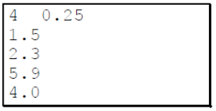
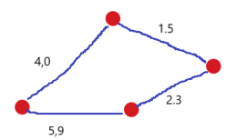
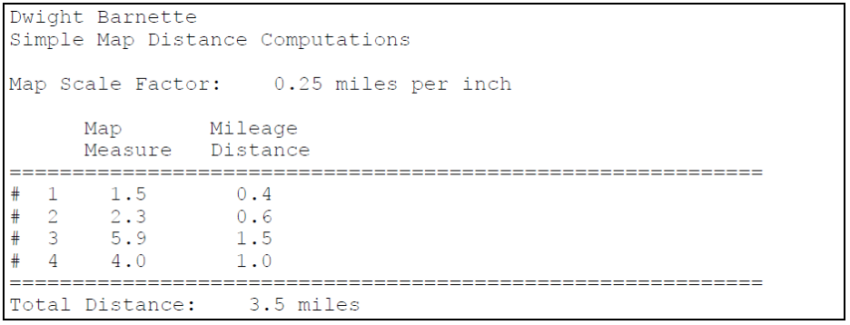
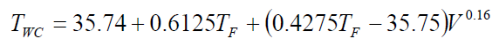
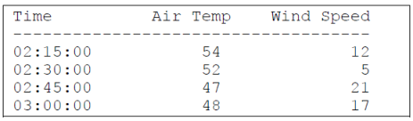
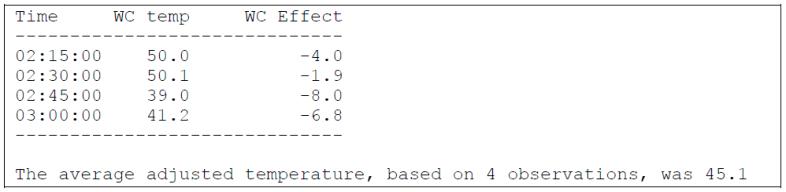

# Практическая работа 2. Типы данных Python. Приведение типов. Решение задач на работу с числовыми данными.

## Запуск

Откройте PowerShell в корне репозитория. Для запуска задания A1 выполните:

```powershell
cd .\Lab_3
python .\A1.py
```

Скрипты `A1.py`, `A2.py` и `A3.py` принимают данные из консоли. Для задачи B1 выполните `python .\B1.py`. Скрипт читает `5.ChaseData.txt` и выводит результат игры в консоль.

## Задача A1

Предположим есть следующий фрагмент программного кода:

```text
width = 17  # ширина
height = 12.0  # высота
```

Для каждого из следующих четырех выражений на Python определите значение выражения и его тип:

```text
1. width//2
2. width/2.0
3. height/3
4. 1 + 2 * 5
```

Используйте интерпретатор Python, чтобы проверить свои ответы.

## Задача A2

Определите, какие из представленных выражений можно преобразовать в целое десятичное число за одну операцию int() , а какие нельзя и почему. 1.  '123е' 2. '91.4' 3. 524.345 \*\* 435345345311145345 4. '7.1 + 4' 5. '4' - 2 6. '4 - 2' 7. '42' 8. -12.12 Проверьте, какую ошибку выдает интерпретатор Python в случае невозможности преобразования.

## Задача A3

Число 3 в степени 9090001 займет в памяти компьютера 1921000 байт. Напишите программу, которая вычисляет сколько это мегабайт. В одном килобайте – 1024 байта, в одном мегабайте – 1024 килобайта.

Проверьте свой результат, воспользовавшись функцией getsizeof() из модуля sys. Для этого необходимо выполнить импорт модуля sys в вашу программу. Функция возвращает размер объекта в байтах. Ваш объект – это число 3 в степени 9090001. Придется несколько подождать, пока функция вернет результат. Пример использования функции для целого числа 5:

```text
import sys
print(sys.getsizeof(5))
```

или так:

```text
from sys import getsizeof
print(getsizeof(5))
```

Не удивляет, почему для числа 5 функция вернет результат 28 байт? Ведь 5 – совсем небольшое

```text
число, | его | вполне | можно | уместить | в | одном | байте. | Ответ | на | Stack | Overflow | -
```

https://stackoverflow.com/questions/10365624/sys-getsizeofint-returns-an-unreasonably-large-value/ Почитывайте иногда https://stackoverflow.com/questions если не можете найти решение своей проблемы. Там есть ответы на многие вопросы.

- [stackoverflow.com](https://stackoverflow.com/questions/10365624/sys-getsizeofint-returns-an-unreasonably-large-value/)
- [stackoverflow.com](https://stackoverflow.com/questions)

## Задача A4

Напишите программу, которая считывает два целых числа A и B и выводит наибольшее из них. Числа — целые от 1 до 1000. !!! При решении задачи можно пользоваться только целочисленными арифметическими операциями. Нельзя пользоваться нелинейными конструкциями: ветвлениями, циклами, функциями.

Можно воспользоваться тернарным оператором или решить задачу, используя списки. Тернарный оператор возвращает одно из двух возможных значений в зависимости от того, является истинным (True) или ложным (False) заданное условие. Например, проверим равны ли два числа a и b:

```text
result = "Числа равны" if a == b else "Числа не равны"
print(result)
```

Здесь "Числа равны" – первое возможное значение; "Числа не равны" – второе возможное значение; a == b – логическое выражение (условие), результат которого True или False; result – переменная, которая в результате выполнения тернарной операции примет одно из возможных значений.

Используя списки, задачу можно решить следующим образом:

```text
result = [a, b][a <= b]
print(result)
```

Здесь \[a, b\] – список из двух объектов; \[a \<= b\] – логическое выражение (условие), результат которого True или False. Если False, то переменная result примет значение первого элемента из списка, то есть a. Если True – то значение второго элемента списка, то есть b. В итоге result – это наибольшее из чисел a и b.

## Задача A5

Проверить, делится ли число A на число B нацело. Использование любых видов ветвлений, функций и т.п. Выведите "YES", если A кратно B и "NO" в противном случае.

## Задача A6

Электронные часы показывают время в формате h:mm:ss, то есть сначала записывается количество часов (число от 0 до 23), потом обязательно двузначное количество минут, затем обязательно двузначное количество секунд. Количество минут и секунд при необходимости дополняются до двузначного числа нулями. С начала суток прошло N секунд. Выведите, что покажут часы. !!! При решении задачи строковый тип разрешается использовать только для вывода результата. Для вывода часов, минут и секунд в требуемом формате можно использовать функцию format(), как в примере ниже, который выведет результат сложения двух чисел в виде 3+05=008

```text
a = 3
b = 5
print('{}+{:02}={:03}'.format(3, 5, a + b))
```

Входные данные:  3602 Вывод программы: 1:00:02 Входные данные: 46867 Вывод программы: 13:01:07 Входные данные: 15 Вывод программы: 0:00:15

## Задача A7

Заданы две клетки шахматной доски. Координаты каждой клетки задаются двумя числами: 1, 1 или 5, 3. Числа вводятся с клавиатуры. Если клетки покрашены в один цвет, то выведите слово YES, а если в разные цвета – то NO. Если клетки одного цвета, то определите и выведите их цвет (White или Black), считая, что клетка (1,1) – белая.

```text
Ввод:
1
1
2
2
Вывод:
YES
White
```

```text
Ввод:
1
1
2
3
Вывод:
NO
```

## Задача B1

Расстояние по карте.  Требуется написать программу расчета расстояния между локациями на карте. Программа считывает входные данные из файла «inmapХ.dat». Файлы доступны по ссылке. Первая строка входного файла содержит два числа, разделенных пробелом:

- Количество мест для посещения (целое число от 1 до 100)
- Масштаб карты (действительное число от 0,0 до 1000,0)

Первое число – это количество локаций на карте, которые посещаются последовательно. Второе число – масштаб карты (количество реальных миль на 1 дюйм на карте). Каждая следующая строка файла содержит одно число – расстояние на карте (в дюймах) между двумя локациями – вещественное число от 0,0 до 1000,0. Количество строк в файле заранее неизвестно.

**Формат данных в файле:**





Требуется найти расстояние, которое придется проехать (в милях), чтобы посетить все локации, а также найти расстояние между двумя соседними (в милях). Результат работы программы вывести в следующем формате:

- Первая строка – ваше имя
- Вторая строка – Simple Map Distance Computations

Далее по образцу:



Все расстояния выводить с одним знаком после запятой, масштаб – два знака после запятой. Протестируйте решение на файлах входных данных inmap0.dat, inmap1.dat, inmap2.dat. Сравнить полученные результаты с содержимым файлов outmap0.dat, outmap1.dat, outmap2.dat. Файлы доступны по ссылке.

- [drive.google.com](https://drive.google.com/drive/folders/1arlPKKEofeqeWxdihf8TrzKWHsGspsOg?usp=sharing)

## Задача B2

Фактор охлаждения ветром. В прогнозе погоды часто можно увидеть упоминание фактора охлаждения ветром (Wind Chill) или ветро-холодовой индекс. Подробнее здесь и здесь. Это кажущаяся температура, которую ощущает кожа в присутствии ветра. Принята следующая формула для вычисления температуры ветрового охлаждения:



TF  - температура по Фаренгейту V – скорость ветра в милях в час (\>3)

Напишите программу, которая читает данные из входного файла X.WCData.txt (формат представлен ниже) и вычисляет WC-эффект (WC Effect), а также среднюю скорректированную температуру, основанную на наблюдениях (The average adjusted temperature based on observations).

**Формат и пример входного файла:**



- Первая строка – заголовки столбцов таблицы
- Вторая строка – не содержит данных

Третья и последующие строки – время наблюдения (представлено в формате HH:MM:SS), температура воздуха в градусах по Фаренгейту (целое число), наблюдаемая скорость ветра в милях в час (целое положительное число).

```text
Программа | должна | сформировать | файл | X.WindChillReport.txt, | содержащий | результаты
```

вычислений в следующем виде:



Протестируйте решение на файлах входных данных 1.WCData.txt, 2.WCData.txt, 3.WCData.txt.

```text
Сравнить | полученные | результаты | с | содержимым | файлов | 1.WindChillReport.txt,
```

2.WindChillReport.txt, 3.WindChillReport.txt. Файлы доступны по ссылке.

- [ru.wikipedia.org](https://ru.wikipedia.org/wiki/%D0%92%D0%B5%D1%82%D1%80%D0%BE-%D1%85%D0%BE%D0%BB%D0%BE%D0%B4%D0%BE%D0%B2%D0%BE%D0%B9_%D0%B8%D0%BD%D0%B4%D0%B5%D0%BA%D1%81)
- [en.wikipedia.org](https://en.wikipedia.org/wiki/Wind_chill)
- [drive.google.com](https://drive.google.com/drive/folders/1yBXyKbuu1FAHlNb3KM8YwO20wWNARFJE?usp=sharing)
