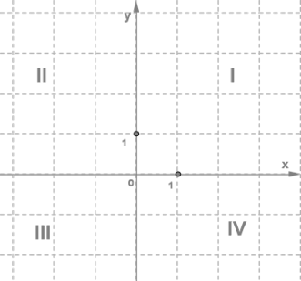
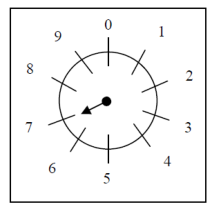
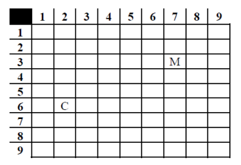
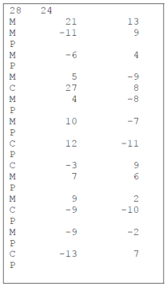
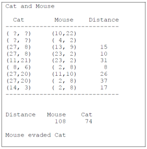

# Практическая работа 3. Реализация алгоритмов ветвления. Условные операторы.

## Запуск

Откройте PowerShell в корне репозитория. Для запуска задания A1 выполните:

```powershell
cd .\Lab_4
python .\A1.py
```

Скрипты `A1.py`–`A4.py` принимают данные из консоли. Для задачи B1 выполните `python .\B1.py`. Скрипт читает `Precip.txt` и записывает отчёт в `Report.txt`.

## Задача A1

Вводятся координаты двух точек на плоскости: x1, y1, x2, y2. Все координаты не равны 0. Определить, лежат ли обе точки в одной координатной четверти. Если да, то определить в какой четверти лежат точки.



```text
Ввод:
3
-3
5
-2
Вывод: Yes, IV
```

```text
Ввод:
3
3
5
-1
Вывод: No
```

<details>
<summary>Подсказки</summary>

Для решения задачи потребуется записать логические выражения, включающие не только операции сравнения, но также некоторые логические операции: and (логическое умножение «И»), or (логическое сложение «ИЛИ»), not (логическое отрицание «НЕ»). Например,

```text
if (x1>0 and y1>0):
    print("I четверть") # точка (x1,y1) лежит в первой координатной четверти
```

</details>

## Задача A2

Напишите программу, которая проверяет введенный пароль на надежность. Требования к надежному паролю следующие:

- Длина пароля – 8 символов
- В пароле должны быть заглавные и строчные буквы, цифры и специальные символы: \*, - , \#

В случае ввода надежного пароля выведите на печать «Надежный пароль». В остальных случаях выведите на печать все ошибки из следующих возможных, допущенные при вводе пароля:

- Длина пароля не равна 8;
- В пароле отсутствуют заглавные буквы;
- В пароле отсутствуют строчные буквы;
- В пароле отсутствуют цифры;
- В пароле отсутствуют специальные символы;
- В пароле используются непредусмотренные символы.

```text
Ввод:
qwerty11
Вывод:
В пароле отсутствуют заглавные буквы
В пароле отсутствуют специальные символы
```

```text
Ввод:
8Yy#*rrT
Вывод:
Надежный пароль
```

```text
Ввод:
@#@@uU
Вывод:
Длина пароля не равна 8
В пароле отсутствуют цифры
В пароле используются непредусмотренные
символы
```

<details>
<summary>Подсказки</summary>

Для решения задачи потребуется использовать условные операторы, а также некоторые возможности работы со строковыми значениями из модуля string. Импортируйте его:

```text
import string
```

Длину введенного пароля (строки) можно получить, используя функцию len(). Функция вернет количество символов в строке.

```text
len(password)
```

Функция lower() преобразует все символы строки в нижний регистр (строчные буквы):

```text
password = '8Yy#*rrT'
print(password.lower())  # вывод - 8yy#*rrt
```

Сравнив исходный пароль с преобразованным к нижнему регистру паролем можно понять, есть ли в строке заглавные буквы. Аналогично, для строчных букв, но с использованием функции upper().

Определить, есть ли в исходной строке хотя бы одна цифра можно с использованием функций isdigit() и any(). Например, следующий ниже вызов функции any() вернет True, если в строке password есть хотя бы одна цифра:

```text
any(symbol.isdigit() for symbol in password)
```

Запись for symbol in password означает, что каждый символ строки password будет проверен функцией isdigit() на то, является символ цифрой (тогда True) или нет (тогда False). Используйте конструкцию из примера в условном операторе if для проверки наличия цифр в строке.

Определить, есть ли в строке недопустимые символы можно следующим образом:

1. Склеим в одну строку все допустимые символы пароля (буквы в нижнем регистре + буквы в верхнем регистре + цифры + специальные символы \*- \#).

```text
allowed = string.ascii_uppercase + string.ascii_lowercase + string.digits + '*-#'
```

Здесь string.ascii\_uppercase (все буквы в верхнем регистре), string.ascii\_lowercase (все буквы в нижнем регистре) и string.digits (все цифры) – это строковые константы модуля string. Подробнее по ссылке. Для проверки выполните фрагмент кода:

```text
allowed = string.ascii_uppercase + string.ascii_lowercase + string.digits + '*-#'
print(allowed)
```

На экран будет выведена строка: ABCDEFGHIJKLMNOPQRSTUVWXYZabcdefghijklmnopqrstuvwxyz0123456789\*-\# 2. Проверим, что все символы пароля присутствуют в этой строке. Если нет – пароль неверный. Это можно сделать, используя функцию all(). Функция возвращает True, если все элементы последовательности True. В нашем случае для каждого символа пароля password достаточно проверить, что он встречается в строке допустимых символов allowed. Если это так, то следующий вызов функции all() вернет True:

```text
all(symbol in allowed for symbol in password)
```

Например, при выполнении следующего фрагмента кода на экран будет выведено True:

```text
password = '11qweQ-s'
allowed = string.ascii_uppercase + string.ascii_lowercase + string.digits + '*-#'
print(all(symbol in allowed for symbol in password))
```

</details>

- [docs.python.org](https://docs.python.org/3.9/library/string.html#string.ascii_uppercase)

## Задача A3

Газовая компания выставляет счет потребителям за каждый использованный кубический метр газа. Раз в месяц сотрудник компании считывает текущее показание счетчика. Компания использует показания за предыдущий месяц и за текущий месяц, чтобы определить, сколько газа потребил заказчик.

Счетчик газа представляет собой круглое устройство, на котором нанесены метки для чисел от 0 до 9999. Стрелка указывает на текущее показание счетчика и перемещается к следующей метке, когда использован один кубометр газа. Когда стрелка достигает отметки 9999 и используется еще один кубометр газа, то счетчик сбрасывается на 0. Ниже представлен рисунок, на котором нанесены метки только для каждой тысячи кубических метров. Стрелка указывает на 7 и это означает, что текущее показание счетчика – 7000 кубометров.



Сотрудник компании записывает текущее показание стрелки и использует показания предыдущего месяца для вычисления общего количества использованного газа. Так, на рисунке, если предыдущее показание было 4000, то объем использованного газа в текущем месяце 7000 - 4000 = 3000 кубометров.

Компания вычисляет сумму денег, которую клиент должен заплатить за использованный газ:

- За любой объем до 300 кубометров (включительно) взымается фиксированная сумма –

21\$

- За любое количество более 300 кубометров, но меньше либо равное 600, дополнительно взымается 0,06\$ за каждый кубометр.
- За любой объем более 600 кубометров и менее или равный 800, компания берет 0,04\$ за кубический метр.
- Наконец, за любую сумму, превышающую 800 кубических метров, они взимают 0,025\$ за кубический метр.

Например, если общий объем использованного газа составляет 470 кубометров, то счет за газ будет рассчитан так:

21 + 170 \* 0,06 = 31,20 \$ Здесь 21\$ покрывают первые 300 кубометров, а оставшиеся 170 оплачиваются из расчета 0,06\$ за каждый.

Напишите программу, которая по двум показаниям счетчика (предыдущее и текущее) определяет объем использованного газа в кубометрах, вычисляет сумму оплаты за газ и среднюю цену за кубометр. Сумму оплаты и средней цены за кубометр округлите при выводе до двух знаков после запятой.

```text
Ввод:
575
1250
Вывод:
Предыдущее | Текущее | Использовано | К оплате | Ср. цена m^3
575 | 1250 | 675 | 42.00 | 0.06
```

```text
Ввод:
8725
150
Вывод:
Предыдущее | Текущее | Использовано | К оплате | Ср. цена m^3
8725 | 150 | 1425 | 62.63 | 0.04
```

```text
Ввод:
2620
4250
Вывод:
Предыдущее | Текущее | Использовано | К оплате | Ср. цена m^3
2620 | 4250 | 1630 | 67.75 | 0.04
```

## Задача B1

Кот и мышь.  Кот и мышь перемещаются в замкнутом пространстве в форме прямоугольной сетки, разделенной на клетки. Каждая клетка помечена парой координат (строка, столбец). На рисунке ниже мышь M находится в клетке (3, 7), а кот C находится в клетке (6, 2).



Каждый может перемещаться по сетке, но не может покидать сетку. Если кот и мышь одновременно достигают той же ячейки, то кот ловит мышь и игра заканчивается. Каждый игрок (кот или мышь) перемещается по строкам и/или столбцам сетки. Ход указывается парой чисел. Например, ход (3, -1) определяет на сколько ячеек игрок должен переместиться по вертикали (первое число) и по горизонтали (второе число). Если бы кот сделал ход (3, -1) из своего местоположения, показанного на рисунке, то он бы оказался в клетке (9, 1). Ни одному игроку не разрешается перемещаться за пределы сетки. Если сделать такой ход, игрок просто перемещается на противоположную сторону сетки. Например, если мышь попытается сделать ход (-4, 2) из своей начальной позиции, то окажется в клетке (8, 9). Если кот попытается сделать (5, -2) из своей исходной позиции, то окажется в клетке (2, 9). Игроки перемещаются по рядам и столбцам, и соответственно рассчитываются пройденные ими расстояния. Учитывая начальные позиции, показанные на рисунке, расстояние между котом и мышью равно 8. Расстояния никогда не бывают отрицательными. Если кот сделала ход (3, -1) из своего начального положения (6, 2), то он прошел расстояние 4. Обратите внимание, что начальное положение не считается перемещением из (0, 0).

Напишите программу, которая считывает данные из файла ChaseData.txt, содержащего данные о начальных позициях и перемещениях игроков, определяет расстояние между игроками, расстояние, пройденное игроками за всю игру, а также исход игры – «Кот поймал мышь» или «Мышь сбежала от кота».

**Формат входных данных:**



- Первая строка – два целых числа (количество строк и столбцов сетки)

Каждая следующая строка представлена в одном из следующих форматов:

```text
M    <число>    <число>       // начальная позиция или ход мыши
C     <число>     <число>      // начальная позиция или ход кота
P    // команда вывода на экран (print) текущего состояния игры
```

**Формат выходных данных:**



- Первая строка – название игры
- Вторая строка – пустая
- Третья строка – названия столбцов таблицы
- Четвертая строка – строка разделительных символов

Пятая и следующие строки – позиции кота и мыши и расстояние между ними. Если на момент выполнения команды P позиция игрока неизвестна, то выводим ( ?, ?). Под таблицей выводятся расстояния, пройденные обоими игроками, а также исход игры.

Файлы доступны по ссылке.

- [drive.google.com](https://drive.google.com/drive/folders/1svC0YAs4Doz-609NstDhmQqjL6M8lUZv?usp=sharing)
