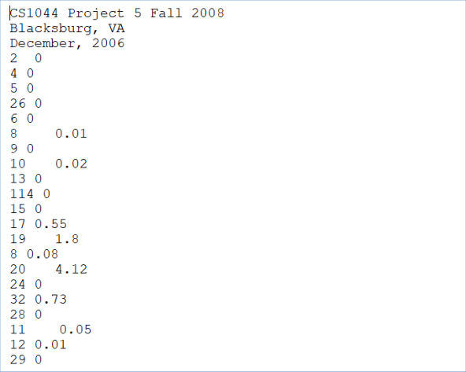
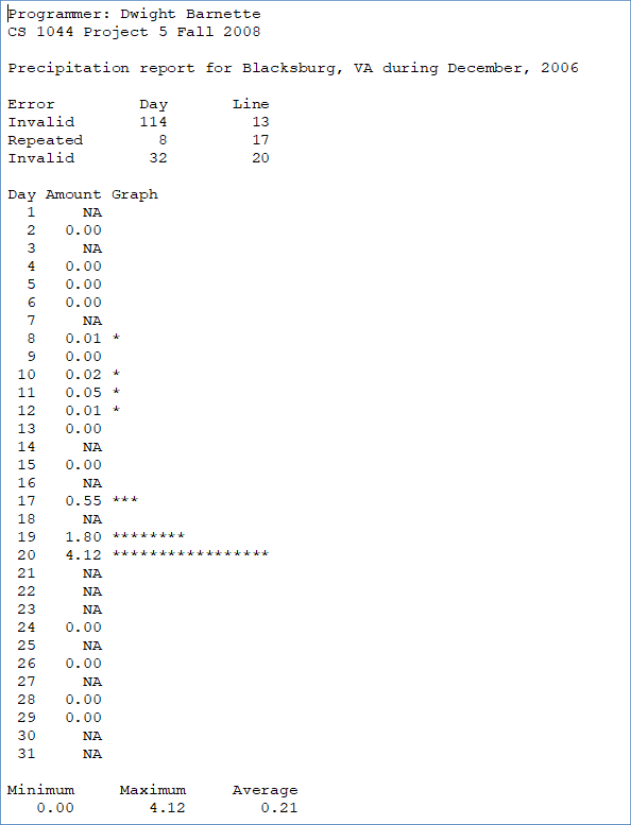

# Практическая работа 4. Операторы цикла. Циклические алгоритмы.

## Задача A1

Создайте тренажёр для изучения таблицы умножения. Программа задаёт N случайных примеров на умножение, ожидает ответа пользователя на каждый пример, подсчитывает количество правильных ответов, затраченное время на каждый пример и на все примеры. После того, как пользователь решит все примеры, программа выдает подробную статистику:

- Общее время, затраченное на ответы (сек.)
- Среднее время на один пример (сек.)
- Количество правильных ответов
- Процент правильных ответов

В случае, если пользователь вводит ответ, не являющийся целым числом, программа повторяет тот же пример, пока пользователь не введет целое число (см. пример работы программы)

**Пример работы программы:**

```text
Введите количество примеров: 5
Вопрос 1/5
2 × 7 = 15
Неверно! Правильно: 14 (Время: 2.9 сек)
Вопрос 2/5
4 × 6 = 24
Верно! (Время: 2.2 сек)
Вопрос 3/5
4 × 3 = qwerty
Пожалуйста, введите целое число!
4 × 3 = 12
Верно! (Время: 19.3 сек)
Вопрос 4/5
7 × 6 = 42
Верно! (Время: 4.7 сек)
Вопрос 5/5
5 × 5 = 17.5
Пожалуйста, введите целое число!
5 × 5 = 25
Верно! (Время: 14.3 сек)
==================================================
СТАТИСТИКА:
==================================================
Общее время: 43.5 секунд
Среднее время на вопрос: 8.7 сек
Правильных ответов: 4/5
Процент правильных: 80.0%
```

<details>
<summary>Подсказки</summary>

**Рекомендации для решения задачи**

Для генерации случайных чисел понадобится модуль random. А для подсчета времени – модуль time.

```text
import random
import time
```

Для генерации N случайных примеров нужен цикл, удобнее всего использовать оператор цикла for:

```text
for i in range(N):
        # здесь код для генерации случайных примеров
```

Случайное число в диапазоне от 2 до 9 можно получить, используя функцию randint() модуля random. Число 1 не используем, так как умножение на 1 слишком простое.

```text
a = random.randint(2, 9)
```

Если перед вызовом функции input, ожидающей от пользователя ввод ответа, засечь текущее время, то после ввода можно посчитать затраченное на ответ время в секундах:

```text
start_time = time.time()                     #текущее время
answer = int(input(f"{a} × {b} = "))       #ввод пользователя
time_spend = time.time() - start_time       #время, затраченное на решение
```

Ввод ответа пользователем можно организовать, используя бесконечный цикл и конструкцию try except. Конструкция try except отловит ошибку (если введено не целое число), а бесконечный цикл будет просить пользователя повторить ввод, до тех пор, пока не будет введено целое число.

```text
while True:                                  #бесконечный цикл
    try:
        answer = int(input(f"{a} × {b} = ")) #ввод пользователя
        break                              #выходим из цикла, если ввод OK
    except ValueError:                      #отлавливаем ошибку ввода
        print("Пожалуйста, введите целое число!")
```

</details>

## Задача A2

Используя вложенные циклы, изобразите следующие фигуры:

- Прямоугольник, размером n\*m (размеры вводятся с клавиатуры)
- Правый треугольник, состоящий из n строк
- Рамку, размером n\*m

**Пример вывода**

```text
РАМКА 5*10:
     ##########
     #                  #
     #                  #
     #                  #
     ##########
```

```text
ПРЯМОУГОЛЬНИК 5x10:
##########
##########
##########
##########
##########
```

```text
ПРАВЫЙ ТРЕУГОЛЬНИК:
#
##
###
####
#####
```

<details>
<summary>Подсказки</summary>

Для задачи с прямоугольником вложенные циклы можно реализовать так:

```text
for i in range(n):      # Внешний цикл - строки
    for j in range(m):  # Внутренний цикл – столбцы
        # Здесь Ваш код
```

Для того, чтобы после вывода каждого символа функция print() не переводила курсор на следующую строку, вызывайте ее так:

```text
print('#', end='')
```

end=''  - предотвращает переход на новую строку после каждого символа, а print() без параметров просто переводит курсор на новую строку.

Если справились, то попробуйте реализовать функции для отображения каждой из фигур. Функция принимает на вход размер (размеры) фигуры и символ, с помощью которого отрисовывается фигура. Например, для прямоугольника определение функции может быть таким:

```text
def draw_rectangle(rows,columns,ch)
```

Здесь rows – количество строк, columns – количество столбцов, ch – печатаемый символ.

</details>

## Задача A3

Вы - сетевой администратор, который в процессе мониторинга сети зафиксировал последовательности успешно доставленных (1) и потерянных (0) пакетов данных. Разработайте программу, для анализа этих последовательностей и выявления критических периодов потерь данных.

Программа должна проанализировать последовательность из нулей (0) и единиц (1), где 1 – пакет успешно доставлен, 0 – пакет потерян. Требуется:

- Осуществить ввод строки, состоящей из 0 и 1. Длина строки должна быть не меньше 5.
- Осуществить проверку корректности ввода, убедившись, что в строке используются только символы 0 и 1.
- Найти общее количество пакетов (это длина входной строки).
- Найти общее количество потерянных пакетов (количество нулей).
- Найти длину самой длинной последовательности потерянных пакетов (подряд идущих нулей).
- Вычислить процент потерь: (Количество потерянных пакетов / Общее количество пакетов) ×

100%

- Оценить качество связи. Если процент потерь:
- 0-1% - Отличное качество
- 1-5% - Хорошее качество
- 5-10% - Удовлетворительное качество
- 10-20% - Плохое качество
- \>20% - Критическое состояние сети

**Примеры работы программы:**

```text
Ввод:
1101000110100011000001101101000110100000001110101
Вывод:
Общее количество пакетов: 49
Количество потерянных пакетов: 28
Длина самой длинной последовательности потерянных пакетов: 7
Процент потерь: 57.1%
Качество связи: критическое состояние сети
```

```text
Ввод:
1111111111
Вывод:
Общее количество пакетов: 10
Количество потерянных пакетов: 0
Длина самой длинной последовательности потерянных пакетов: 0
Процент потерь: 0.0%
Качество связи: отличное
```

```text
Ввод:
10001000010
Вывод:
Общее количество пакетов: 11
Количество потерянных пакетов: 9
Длина самой длинной последовательности потерянных пакетов: 4
Процент потерь: 81.8%
Качество связи: критическое состояние сети
```

<details>
<summary>Подсказки</summary>

**Рекомендации по решению задачи**

1. Проверить, что введенная строка содержит только символы 0 и 1 можно следующим образом:

```text
packets = '10001000010'
if not all(char in '01' for char in packets):
        print("Неверный ввод. Используйте только символы '0' и '1'!")
```

Изучите эту конструкцию, а также назначение функции all().

2. Общее количество потерянных пакетов легко посчитать, используя для исходной строки функцию count()

```text
packets.count('0')
```

3. Цикл для перебора всех элементов исходной строки можно организовать так:

```text
for packet in packets:
        if packet == '0':
            # Здесь и далее ваш код
```

</details>

## Задача A4

Решите задачу «Валидатор номеров кредитных карт», продемонстрированную в “Лекция 6. Функции в Python. Аргументы и параметры функции”. Разберитесь в представленном на образовательном портале примере решения этой задачи. Если обнаружите ошибки в реализации, исправьте их.

## Задача B1

Мониторинг осадков.  Национальный центр климатических данных нанял Вас для написания программы, генерирующей отчет по суточным объемам осадков. Проблема в том, что компьютерный сбой привел к тому, что некоторые данные в исходных файлах отображаются в неправильном порядке, потеряны или имеют неверно записанную дату. Вам необходимо распознать ошибки в файле данных и отобразить сводку о суточных объемах осадков за указанный месяц.

**Входной файл.**

Входной файл для этой программы называется Precip.txt. Первая строка файла содержит информацию, которую не нужно обрабатывать. Вторая строка содержит местоположение метеостанции, сообщающей об осадках. Третья строка содержит полное название месяца (с заглавной буквы) и через запятую год, в котором фиксировались данные об осадках. Четвертая и последующие строки содержат день и количество осадков в дюймах, зарегистрированное в этот день.



Ваша программа должны считать информацию об осадках и вычислить минимальное, максимальное и среднее значения количества осадков.

Входной файл может содержать два типа ошибок. Первый тип (Invalid): день, указанный во входных данных, может быть недопустимым для указанного месяца. Второй тип (Repeated): файл может содержать несколько записей для одного и того же дня.

Эти ошибки должны распознаваться, и должно выводиться сообщение об ошибке, содержащее номер строки, в которой обнаружена ошибка. Смотрите ниже пример выходного файла Report.txt. Там указан точный формат вывода сообщений об ошибках.

**Выходной файл:**

Выходной файл называется Report.txt. Пример выходного файла, соответствующий приведенному входному файлу, показан ниже. Первые две строки содержат информацию о программисте и проекте. Третья строка пустая. Четвертая строка содержит местоположение, месяц и год. Пятая строка пустая. Остальная информация выводится в следующем порядке:

- Список всех ошибок, обнаруженных в файле.
- Гистограмма количества осадков. Выводится день и количество осадков с точностью до двух знаков. Далее в этой же строке отображается график, содержащий одну звездочку (\*) для каждых 0.25 дюйма или их части. Например, осадки в количестве 0.01 - 0.25 дюйма отображаются одной звездой, 0.26 - 0.50 – две звезды, 0.51 - 0.75 – три звезды и т.д. Если данные об осадках за день недоступны, вместо их количества выводим "NA".
- Максимальное, минимальное и среднее количество осадков. Если за весь месяц нет доступной информации, для всех трех значений должно быть выведено "NA".



Файлы входных и выходных данных для тестирования работы программы находятся по ссылке.

- [drive.google.com](https://drive.google.com/drive/folders/165sW8aMTBKu-0XSV7XZ0xnN0nS8ZSctL?usp=sharing)
