# Практическая работа 5. Работа со строками. Анализ и обработка текстовых данных.

## Задача A1

Напишите программу, которая укорачивает входной текст, удалив из текста все, что написано в круглых скобках, включая сами скобки. Для решения задачи, реализуйте функцию, которая получает на вход исходный текст, а возвращает – укороченный.

**Пример работы программы:**

```text
Исходный текст: Падал (куда он там падал) прошлогодний (значит очень старый) снег (а почему не
дождь) () (()).
Укороченный текст: Падал прошлогодний снег.
```

<details>
<summary>Подсказки</summary>

Для поиска в исходном тексте скобок, используйте функции find() или rfind(). Функции возвращают позицию (индекс) найденного в строке символа, если таковой имеется:

```text
text = 'Падал (куда он там падал)'
position = text.rfind('(')
```

Для того, чтобы заменить фрагмент текста на пустую строку, можно использовать функцию replace(). Например, так можно удалить из текста символы с 5-го по 10-тый:

```text
left = 5
right = 10
text = text.replace(text[left:right + 1], '')
```

</details>

## Задача A2

Дан текст, состоящий из предложений. Предложения текста заканчиваются символами точка, восклицательный или вопросительный знак. Найдите количество предложений в тексте и выведите все предложения на экран, по одному в каждой строке. Учтите, что между предложениями может быть более одного пробельного символа. Лишние пробелы выводить не надо.

**Пример работы программы:**

```text
Ввод:
He jests at scars. That never felt a wound!        Hello, friend!    Are you OK?
Вывод:
He jests at scars.
That never felt a wound!
Hello, friend!
Are you OK?
Предложений в тексте: 4
```

<details>
<summary>Подсказки</summary>

Разделить текст на предложения можно используя регулярные выражения. Для этого понадобится библиотека re и функция split().

```text
import re
sentences = re.split(r'(?<=[.?!]) ', text)
```

Регулярное выражение r'(?\<=\[.?!\]) ' используется здесь для поиска пробела, который следует сразу после точки, знака вопроса или восклицательного знака. Разберитесь, почему так составлено регулярное выражение.

</details>

## Задача A3

Исходный текст состоит из слов, разделенных пробелом. Требуется получить строку, которая состоит только из первых букв каждого слова (аббревиатура). Дополнительные условия:

- Все буквы аббревиатуры должны быть в верхнем регистре.
- В аббревиатуру не включаются первые буквы слов, длина которых меньше 3.

**Пример работы программы:**

```text
Ввод: New York City
Вывод: NYC
```

```text
Ввод: Yanka Kupala State University of Grodno
Вывод: YKSUG
```

## Задача A4

Генетический поиск

Белок представляет собой большую молекулу, вырабатываемую в клетке живого организма. Каждый белок состоит из аминокислот, соединенных в цепочку. Существует 20 различных аминокислот со сложной химической структурой, различные комбинации которых создают молекулы белков. Для простоты понимания генетики каждой из 20 аминокислот присвоена буква алфавита: Глицин - G, Лейцин - L, Аланин - A, и т.д. Используются следующие 20 букв:

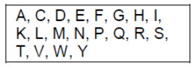

Например, следующая цепочка аминокислот взята из белка “C-FLIP AMPA glutamate”, который содержится в золотой рыбке:

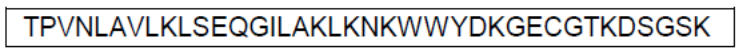

В этом проекте используются два входных файла. Один файл sequences.txt содержит генетические данные, а другой файл commands.txt - содержит команды, которые необходимо выполнить над этими данными.

Во входном файле sequences.txt каждая строка содержит название белка, название организма, в котором он обнаружен, и цепочку аминокислот. Данные разделены символом табуляции. На рисунке ниже представлен пример файла sequences.txt. Знаком → обозначен символ табуляции, а знаком ¶ - символ конца строки.

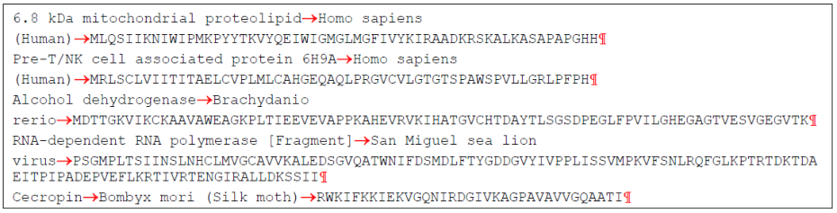

Во входном файле commands.txt каждая строка содержит название операции, которую необходимо выполнить над входными данными файла sequences.txt. Возможные операции: search, diff, mode. У каждой операции есть параметры.

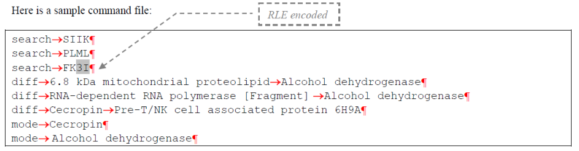

Цепочка аминокислот может быть закодирована с использованием простой техники сжатия Run-Length Encoding (RLE) - кодирование повторов. RLE - это алгоритм сжатия данных, заменяющий повторяющиеся символы (серии) на один символ и число его повторов. Серией называется последовательность, состоящая из нескольких одинаковых символов. Рассмотрим следующий фрагмент гена обыкновенной плодовой мухи:

```text
AAAAAAAATATTTCGCTTTTCAAAAATTGTCAGATGAGAGAAAAAATAAAA
```

Кодирование этого фрагмента с использованием алгоритма RLE дает следующую последовательность:

```text
8ATA3TCGC4TC5ATTGTCAGATGAGAG6AT4A
```

Обратите внимание, что последовательностям из 1-ой или 2-х одинаковых букв не предшествует цифра. Такие серии не кодируются, так как это не приведет к сжатию данных. Считайте также, что ни одна белковая последовательность не содержит цепочек, состоящих более чем из 9 одинаковых букв.

Операция search. Операция search в файле commands.txt имеет следующий формат записи:

```text
search<tab><последовательность аминокислот><newline>
```

Выполнение операции search означает, что во входных данных из файла sequences.txt необходимо найти указанную \<последовательность аминокислот\>. Для каждого белка, содержащего эту последовательность, необходимо записать в выходной файл genedata.txt название организма и соответствующий белок. Если совпадений не найдено, то записать сообщение “NOT FOUND”. В примере ниже, последовательность аминокислот SIIK найдена в организме Homo sapiens (Human) в белке 6.8 kDa mitochondrial proteolipid.

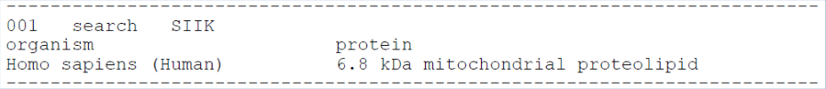

А следующий пример вывода означает, что последовательность аминокислот FKIII не обнаружена ни в одном белке входного файла:

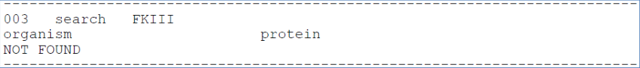

Выводимые в начале строки цифры (001 или 003) - это порядковые номера операций по ходу их чтения из файла commands.txt.

Операция diff. Операция diff имеет следующий формат записи:

```text
diff<tab><белок 1><tab><белок 2><newline>
```

Выполнение команды diff означает, что необходимо определить, сколько аминокислот необходимо заменить, чтобы генетически превратить белок 1 в белок 2. Это можно легко сделать, сравнив аминокислотные цепочки обоих белков и посчитав количество позиций, в которых эти две последовательности различаются. Для белков из примера ниже количество таких позиций равно 81.

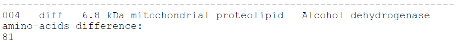

Учитывайте, что длины цепочек белка 1 и белка 2 чаще всего различны. Если белок 1 или белок 2 не найден в файле исходных данных sequences.txt, то после строки «amino-acids difference:» должно быть выведено сообщение «MISSING:», за которым следует название(я) отсутствующего(их) белка(ов).

Операция mode. Операция mode имеет следующий формат записи:

```text
mode<tab><название белка><newline>
```

Выполнение операции mode означает, что необходимо найти во входных данных указанный белок, а в его цепочке найти аминокислоту, которая встречается чаще всего. Если найдется более одной такой аминокислоты, то выведите ту, которая стоит первой в алфавитном порядке. В примере ниже в белке Cecropin чаще всего (5 раз) встречается аминокислота A. А в белке Alcohol dehydrogenase чаще всего (11 раз) встречается аминокислота V.

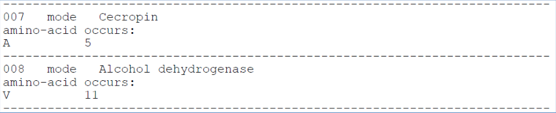

Если белок не найден в исходном файле, то в строке, следующей за «amino-acid occurs:», выведите сообщение «MISSING:», за которым следует название отсутствующего белка.

**Формат выходного файла и пример:**

Ваша программа должна выполнить все операции из файла commands.txt над данными из файла sequences.txt и записать результат выполнения этих операций в файл genedata.txt. При записи в выходной файл RLE-кодирование не используется. То есть, если у операции search был параметр FK3I, то в выходной файл он записывается как FKIII.

Первая строка файла должна содержать только ваше имя; вторая строка должна содержать заголовок «Генетический поиск». Следующие строки содержат данные об операциях и результатах их выполнения. Описание операции начинается с трехзначного номера операции, заполненного нулями (001, 002, 003, …, 009, 010, 011,..). Для удобства чтения, вывод данных по каждой операции разделяется линиями знаков тире. Для операции search:

- выводим название организма и название белка
- если совпадений не найдено, выводим «NOT FOUND»

Для операции diff:

- выводим количество аминокислот, которыми различаются белки

Для операции mode:

- выводим наиболее часто встречающуюся аминокислоту и количество раз, которое она встречается в организме.

**Пример входного файла sequences.txt**

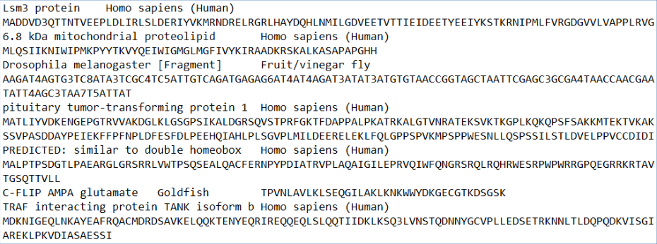

**Пример входного файла commands.txt**

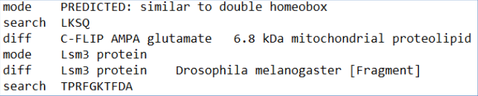

**Пример выходного файла genedata.txt для исходных данных, представленных выше:**

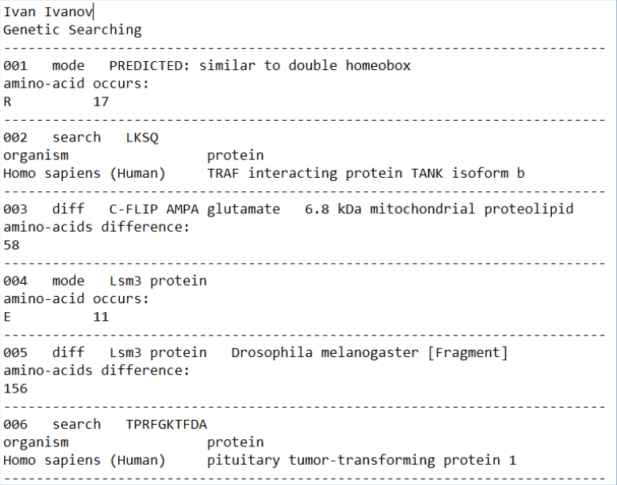

- [ru.wikipedia.org](https://ru.wikipedia.org/wiki/%D0%97%D0%BE%D0%BB%D0%BE%D1%82%D0%B0%D1%8F_%D1%80%D1%8B%D0%B1%D0%BA%D0%B0)
