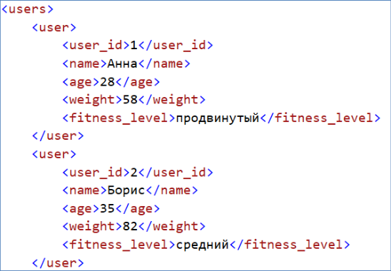
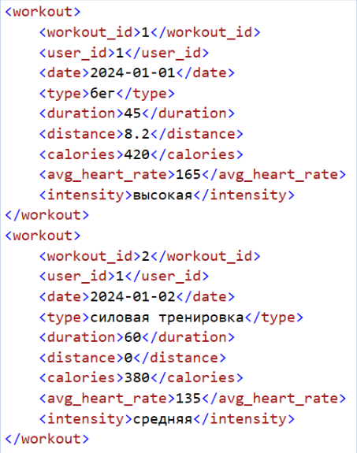
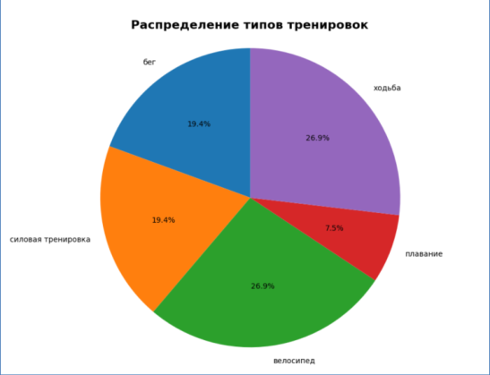
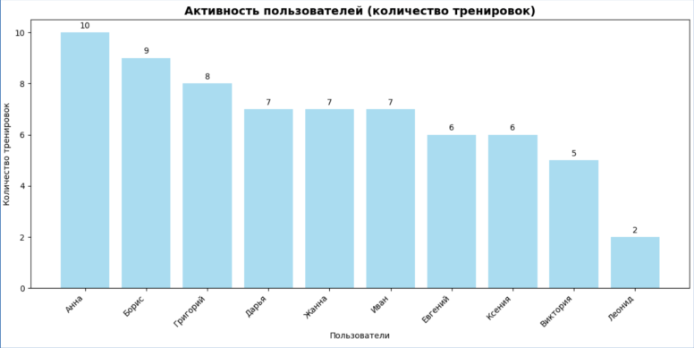
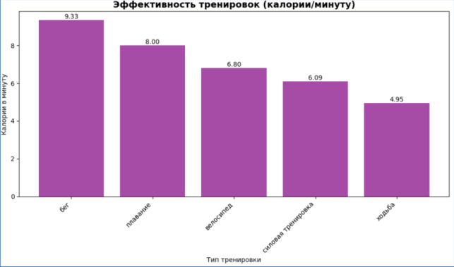
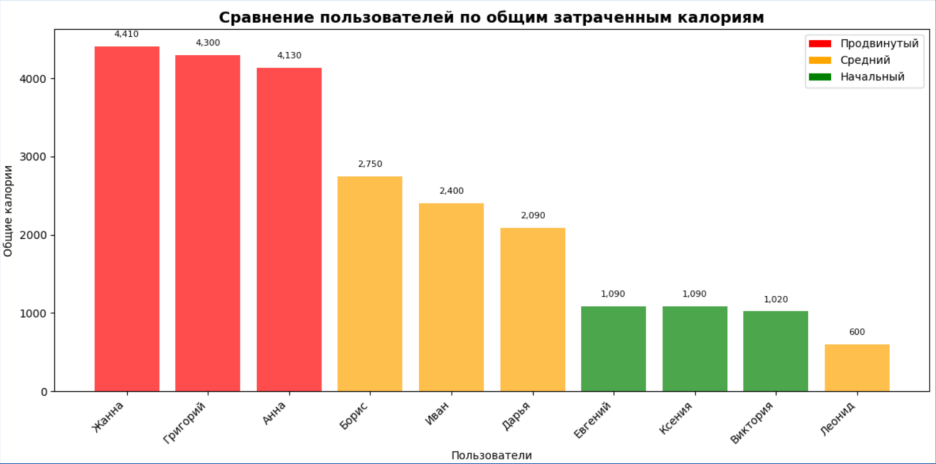

# Практическая работа 6. Обработка, анализ и визуализация данных.

## Исходные данные

При выполнении этого практического задания вы будете работать с данными фитнес-трекера, представленными в XML формате. Даны два файла входных данных:

- users.xml (данные о пользователях);
- workouts.xml (данные о тренировках пользователей).

Данные о пользователях представлены на рисунке ниже и содержат:

- уникальный идентификатор пользователя user\_id
- имя name
- возраст age
- вес weight
- уровень подготовки fitness\_level (продвинутый, средний, начальный)



Данные о тренировках представлены на рисунке ниже и содержат:

- уникальный идентификатор тренировка workout\_id
- уникальный идентификатор пользователя user\_id
- дата тренировки date в формате ГГГГ-ММ-ДД
- тип тренировки type (бег/ходьба/велосипед/плавание/силовая тренировка)
- продолжительность тренировки в минутах duration
- дистанция distance в км (0 для силовых тренировок)
- количество затраченных калорий calories
- средний пульс avg\_heart\_rate
- интенсивность тренировки intensity (высокая, средняя, низкая)



Вам предстоит решить 3 последовательных задачи, где каждая следующая задача использует результаты предыдущей.

## Задача 1

Загрузите данные из xml-файлов и рассчитайте общую статистику по всем тренировкам. Для этого требуется:

- реализовать функцию load\_users\_data() для загрузки данных о пользователях;
- реализовать функцию load\_workouts\_data() для загрузки данных о тренировках;
- реализовать функцию get\_stats(users, workouts) для расчета общей статистики

```text
ОБЩАЯ СТАТИСТИКА
===========================
Всего тренировок: 67
Всего пользователей: 10
Сожжено калорий: 23880
Общее время: 57.1 часов
Пройдено дистанции: 547.6 км
```

## Задача 2

Найдите ТОП-3 самых активных пользователей, выведите распределение данных по типам тренировок, а также выполните детальный анализ тренировок по имени пользователя. Для этого требуется:

- реализовать функцию analyze\_user\_activity(users), которая для каждого пользователя посчитает общее количество тренировок, общее количество калорий, суммарное время тренировок (в часах) и выведет 3-х самых активных пользователей в следующем виде:

```text
ТОП-3 АКТИВНЫХ ПОЛЬЗОВАТЕЛЕЙ:
  1. Анна (продвинутый):
   Тренировок: 10
   Калорий: 4130
   Время: 9.0 часов
  2. Борис (средний):
   Тренировок: 9
   Калорий: 2750
   Время: 7.4 часов
  3. Григорий (продвинутый):
   Тренировок: 8
   Калорий: 4300
   Время: 8.8 часов
```

- реализовать функцию analyze\_workout\_types(workouts), которая выведет распределение по типам тренировок в следующем виде:

```text
РАСПРЕДЕЛЕНИЕ ПО ТИПАМ ТРЕНИРОВОК:
  Бег: 13 тренировок (19.4%)
    Средняя длительность: 62 мин
    Средние калории: 575 ккал
  Силовая тренировка: 13 тренировок (19.4%)
    Средняя длительность: 56 мин
    Средние калории: 343 ккал
  Велосипед: 18 тренировок (26.9%)
    Средняя длительность: 53 мин
    Средние калории: 366 ккал
  Плавание: 5 тренировок (7.5%)
    Средняя длительность: 46 мин
    Средние калории: 368 ккал
  Ходьба: 18 тренировок (26.9%)
    Средняя длительность: 39 мин
    Средние калории: 196 ккал
```

- реализовать функцию find\_user\_workouts(users, user\_name), которая находит и возвращает все тренировки пользователя по имени
- реализовать функцию analyze\_user(user, workouts), которая выводит детальный анализ тренировок пользователя по имени в следующем виде:

```text
ДЕТАЛЬНЫЙ АНАЛИЗ ДЛЯ ПОЛЬЗОВАТЕЛЯ: Борис
===========================================
Возраст: 35 лет, Вес: 82 кг
Уровень: средний
Тренировок: 9
Сожжено калорий: 2750
Общее время: 7.4 часов
Пройдено дистанции: 64.3 км
Средние калории за тренировку: 306
Любимый тип тренировки: ходьба
```

## Задача 3

Выполните визуализацию данных, построив следующие диаграммы:

- круговая диаграмма типов тренировок



- столбчатая диаграмма активности пользователей



- столбчатая диаграмма эффективности тренировок



- сравнительная диаграмма пользователей



<details>
<summary>Подсказки</summary>

**Рекомендации по решению задачи**

1. Для работы с данными в формате xml воспользуйтесь пакетом xml.etree.ElementTree. А для отрисовки диаграмм – пакетом matplotlib.pyplot

```text
import xml.etree.ElementTree as ET
import matplotlib.pyplot as plt
```

2. Загрузку данных о пользователях из файла users.xml можно реализовать так:

```text
def load_users_data():
    try:
        users_tree = ET.parse('users.xml')
        users = []
        for user_elem in users_tree.getroot().findall('user'):
            user = {
                'user_id': int(user_elem.find('user_id').text),
                'name': user_elem.find('name').text,
                'age': int(user_elem.find('age').text),
                'weight': int(user_elem.find('weight').text),
                'fitness_level': user_elem.find('fitness_level').text,
                'workouts': []
            }
            users.append(user)
        return users
    except FileNotFoundError:
        print("Файл не найден")
        return []
```

Аналогично выполняется загрузка данных о тренировках. В дальнейшем выбрать из списка тренировок все тренировки конкретного пользователя можно по user\_id.

3. Если workouts – это список всех тренировок, то найти общее количество, например, потраченных калорий, можно с использованием функции sum для всех элементов списка workouts

```text
total_calories = sum(workout['calories'] for workout in workouts)
```

4. Если users – это список пользователей, который вернула функция load\_users\_data() и где каждый элемент списка – это словарь, то найти пользователя по имени можно следующим образом:

```text
user = next((u for u in users if u['name'].lower() == user_name.lower()), None)
```

</details>
